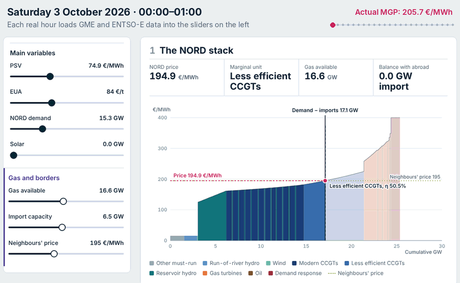
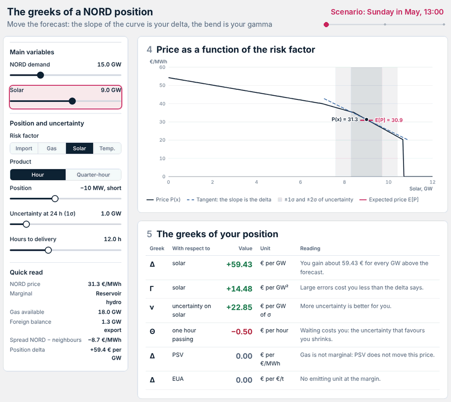

# MOQA — Merit Order Quant Analysis · v0.1 · Northern Italy (NORD)

An interactive merit-order model of the Northern Italy price zone (NORD): the supply stack hour by
hour, its price against the actual MGP price for every hour of October 2026, and the greeks of a
position on a NORD product. One self-contained page, public data only (GME, ENTSO-E).

**The stack, hour by hour.** Each real hour loads GME and ENTSO-E data into the sliders on the left;
move a slider yourself and the stack and the price update.



**The greeks of a position.** The slope of the price curve is the delta, its bend is the gamma;
uncertainty, time to delivery and position size move vega, theta and every sign.



## Quick start

1. Download the repository (Code → Download ZIP) or clone it.
2. Open `index.html` in a browser. No server and no install: the October 2026 data are already in `data/`.

The page opens on the *Base* scenario (an October weekday at 19:00). Pick any real day and hour in the
left panel (or press *Ultima ora* for the latest one), or click a point
on the chart in section 9, and the whole page recomputes for that hour. Every slider (PSV, EUA,
demand, solar, gas available, import capacity, neighbours' price, water value…) moves the stack and
the price live.

Under the section menu, the **history slider** runs over every hour of the data: drag it (or use the
arrow keys, or press ▶ to play the hours one after another) and the stack, the charts and the greeks
follow hour by hour. The faint line behind it is the actual MGP price of the month.

Two buttons at the top right switch the language (Italian / English) and the theme (light / dark);
the choice is remembered in the browser. Links can set both: `index.html?lang=en&theme=dark`.
The English texts live in `i18n/en.js` (see *Translations* below). Map of the sections:

| # | Section | What it shows |
|---|---|---|
| 1 | *Stack* | The NORD merit order for the selected hour, marginal unit and clearing price |
| 2 | *Parco e costi* | Fleet by technology and short-run marginal costs on PSV and EUA |
| 3 | *Frontiere* | Imports from Switzerland, France, Austria and Slovenia: flows and capacity in the loaded hour, price as a function of import capacity, whether the border is saturated |
| 4 | *Prezzo e rischio* | Price as a function of the chosen risk factor (import capacity, gas available, solar, temperature) |
| 5 | *Greche* | Delta, gamma, vega and theta of the position, plus deltas to PSV and EUA |
| 6 | *P&L* | P&L with full revaluation vs the greek approximations |
| 7 | *Calcoli* | Every formula, step by step, with the numbers of the selected hour; model assumptions; glossary |
| 8 | *REMIT* | Unavailable capacity by source, hour by hour (ENTSO-E A80); the outages active in the loaded hour or in the whole month (unit, source, planned or forced, MW, from, to, last update, reason); what the model price would be without the gas outages |
| 9 | *Mese reale* | Model price vs actual MGP NORD price, every hour of the month; mean error and MAE |

## The model in one paragraph

Zero-cost block (other must-run, run-of-river hydro, wind, solar) → reservoir hydro and pumped
storage offered around a water value → gas fleet in three efficiency bands priced on PSV and EUA
(SRMC = PSV ÷ η + EUA × 0.2016 ÷ η + VOM) → oil and demand response, with a scarcity mark-up.
Imports and exports with the neighbours are one aggregate neighbour priced at the average of the
French and Swiss day-ahead prices, bounded by the day-ahead capacities; the flow to the Centre-North
zone is taken from the data and added to demand. The clearing price solves supply + net imports =
demand. Section 7 lists every assumption.

## Data

`data/2026-10/` holds the raw files, one per dataset and zone, exactly as stored in the archive the
page was built from. Timestamps in UTC (`ts_utc`) and Italian time (`ts_italia`); values as published
(EUR/MWh, MW), with the prefix of the source (`gme_`, `entsoe_`, `tv_`). Nothing is recalculated in
these files.

| File | Source | Content | Resolution | Used by the page |
|---|---|---|---|---|
| `GME_MGP_NORD.csv` | GME | Day-ahead (MGP) price, NORD zone | 15 min | yes: the actual price in section 9 |
| `GME_MI1_NORD.csv` … `GME_MI3_NORD.csv` | GME | Intraday auction (MI-A1, MI-A2, MI-A3) prices, NORD zone | 15 min | no |
| `A65_IT_NORD.csv` | ENTSO-E | Actual total load | 15 min | yes |
| `A75_IT_NORD.csv` | ENTSO-E | Actual generation per production type | 15 min | yes |
| `A71_IT_NORD.csv` | ENTSO-E | Installed capacity per production unit (≥ 100 MW), start of the year | yearly | yes |
| `A80_IT_NORD.csv` | ENTSO-E | Unavailability of generation units (REMIT), every version of the events touching the month | event | yes |
| `A11_<from>-<to>.csv` | ENTSO-E | Physical flows on the NORD borders (CH, FR, AT, SI, Centre-North), both directions | 15 min / hourly | yes |
| `A09_DA_<from>-<to>.csv` | ENTSO-E | Day-ahead scheduled exchanges, both directions | 15 min | no |
| `A61_<from>-<to>.csv` | ENTSO-E | Day-ahead forecast transfer capacity, both directions | hourly | foreign borders only |
| `A44_FR.csv`, `A44_CH.csv` | ENTSO-E | Day-ahead prices of France and Switzerland (the neighbours' price) | 15 min / hourly | yes |
| `TV_PSV.csv`, `TV_EUA.csv` | TradingView | Daily front-month bars, PSV gas and EU carbon | trading day | yes |
| `fonti.json` | — | Archive version, rows and expected rows for each file | — | — |
| `calc_orario.csv` | calculated | The hourly table behind the page (`calc_` columns only) | hourly | — |

ENTSO-E does not publish the installed capacity per production type (A68) for the NORD zone, so the
installed capacity comes from the list of production units (A71), exported from the Transparency
Platform website and converted with `scripts/importa_a71.py`. File by file, in Italian:
[docs/datasets.md](docs/datasets.md).

`data/moqa_dati.js` is the same hourly table in the format `index.html` reads. Rebuild it from the
raw files with:

```bash
pip install -r requirements.txt
python scripts/importa_a71.py --xlsx GUI_GENERATION_INSTALLED_PERUNIT_202512312300-202612312300.xlsx --mese 2026-10   # only when A71 changes
python scripts/costruisci_dati.py --mese 2026-10
python -m pytest -q
```

How the hourly table is built (`scripts/costruisci_dati.py`): hourly means of the 15-minute series,
MW → GW; net imports = into NORD − out of NORD on each border; import and export capacity = sum of
the A61 capacities on the four foreign borders; neighbours' price = mean of the French and Swiss
day-ahead prices; gas, hydro and coal available = installed capacity at the start of the year (sum
of the A71 units) − A80 unavailability (latest version of each event, cancelled and withdrawn
documents dropped, time-weighted within the hour, a unit in several events counted once); PSV and
EUA = last daily close up to the loaded hour.

The technology of each A80 unavailability is taken from A71, matching the plant EIC code, not from
the A80 message: in October 2026, 20 NORD combined-cycle plants are declared in A80 as geothermal
(B09) and one with no type, while A71 lists them as Fossil Gas. All 51 units with an A80 message in
the month are in A71. Gas (B04), reservoir hydro and pumped storage (B10, B12) and coal (B02, B05)
are subtracted; all other types are shown in section 8 but not subtracted. With A71, October 2026
has 24.3 GW of gas and 6.2 GW of reservoir hydro and pumped storage installed; gas available ranges
from 16.2 to 18.6 GW over the month.

**Sources.** [GME — Gestore dei Mercati Energetici](https://www.mercatoelettrico.org) for the MGP and
MI-A prices; [ENTSO-E Transparency Platform](https://transparency.entsoe.eu) for load, generation,
capacity, unavailability, flows and neighbours' prices; TradingView for the PSV and EUA closes.

## Translations

The page is written in Italian. In English, every visible text is looked up in `i18n/en.js`: the key
is the Italian text with each number replaced by `{0}`, `{1}`…, so one entry covers every hour and
every value, and numbers switch to the English format (1.234,5 → 1,234.5). A text without an entry
stays in Italian; the causes written by plant operators in REMIT messages are left as published. To
find texts still missing, open the page with `?lang=en` and run `MOQA_i18n.missing` in the browser
console.

## Known limitations (v0.1)

- **One month of data.** v0.1 shows the model at work on October 2026; it is not a validated backtest.
  With the default panel, the model sits on average 27.5 €/MWh below the actual MGP price (MAE
  27.8 €/MWh): the gap points at the unobserved parameters below.
- **Parameters not observed in the data** — water value of reservoir hydro, efficiency bands of the
  gas fleet, scarcity mark-up, temperature sensitivity — are set in the panel and apply to every
  hour; section 9 shows how far the model sits from the actual MGP price with those settings.
- **One aggregate neighbour.** Flow-based coupling, loop flows and border-by-border prices are not
  modelled; the Centre-North exchange is taken as given.
- **No negative prices.** The stack does not go below zero.
- **Nominal capacity.** Available capacity is A71 capacity minus REMIT outages. Derating that is not
  published as a REMIT message (ambient temperature, small reductions) is not subtracted: on
  1 October at 12:00, on the units both sources list, Terna's available capacity is about 0.9 GW
  lower than A71 − A80.
- **Units declared "Other" in A71** (one 840 MW unit named as a CCGT, one battery) stay outside the
  gas fleet.

## Roadmap

- Longer history (January 2026 onwards) and calibration of the unobserved parameters.
- Merit-order greeks estimated on history: €/MWh per GW of residual load, by hour.

## License

Code: [MIT](LICENSE). Data: see *Sources* above.

Constantin Alexandru Radu · [LinkedIn](https://www.linkedin.com/in/alexandru-radu02)
